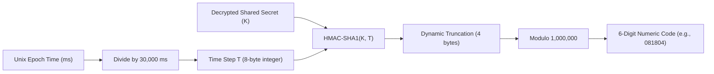

# Multi-Factor Authentication (MFA) & Google Authenticator: Architectural Theory

## 1. What is Multi-Factor Authentication (MFA)?

Authentication traditionally relies on credentials belonging to three fundamental factors:
1. **Something you know:** Passwords, PINs, or security answers.
2. **Something you have:** A smartphone with an authenticator app, a hardware security key (FIDO2/WebAuthn), or a smartcard.
3. **Something you are:** Biometrics such as fingerprints, facial recognition, or iris scans.

Single-factor authentication (passwords alone) is vulnerable to credential stuffing, phishing, password reuse, and data leaks. **Multi-Factor Authentication (MFA)** requires verifying at least two independent factors before granting access. Even if an attacker discovers or steals a user's password, they cannot access the system without the physical second factor.

---

## 2. What is Google Authenticator & TOTP?

**Google Authenticator** is a mobile application that generates time-sensitive, one-time verification codes based on open Internet Engineering Task Force (IETF) industry standards:
* **RFC 4226 (HOTP):** An HMAC-Based One-Time Password Algorithm.
* **RFC 6238 (TOTP):** A Time-Based One-Time Password Algorithm (an extension of HOTP).

Google Authenticator does **not** communicate with Google's servers to generate or verify codes. It is completely offline and decentralized. The security relies entirely on a **shared secret** securely established between the server and the user's authenticator app during initial setup.

---

## 3. How TOTP Generates 6-Digit Codes

TOTP replaces the moving event counter in HOTP with the current Unix epoch time divided into fixed intervals (typically 30 seconds):



### Mathematical Steps:
1. **Time Counter ($T$):**
   $$T = \lfloor \frac{\text{Current Timestamp in Seconds}}{30} \rfloor$$
2. **HMAC Calculation:**
   $$H = \text{HMAC-SHA1}(\text{Secret Key}, T)$$
   This generates a 20-byte cryptographic hash.
3. **Dynamic Truncation:**
   The last nibble (lowest 4 bits) of $H[19]$ indicates an offset $O \in [0, 15]$. A 4-byte slice starting at $O$ is extracted and masked:
   $$\text{Binary Code} = (H[O] \ \& \ 0x7F) \ll 24 \mid (H[O+1] \ \& \ 0xFF) \ll 16 \mid (H[O+2] \ \& \ 0xFF) \ll 8 \mid (H[O+3] \ \& \ 0xFF)$$
4. **Modulo Operation:**
   $$\text{TOTP} = \text{Binary Code} \pmod{10^6}$$
   The result is padded with leading zeros to guarantee a 6-digit number.

Every 30 seconds, $T$ increments, producing a completely new 6-digit code.

---

## 4. The Shared Secret & Base32 Encoding

* During enrollment, the server generates 20 bytes (160 bits) of cryptographically random entropy via `node:crypto.randomBytes(20)`.
* This secret is encoded using **Base32 (RFC 4648)** using the alphabet `A-Z` and `2-7`. Base32 is chosen because it avoids ambiguous characters like `0` (zero) vs. `O` (capital o), and `1` (one) vs. `l` (lowercase L), making manual typing straightforward if camera scanning fails.

---

## 5. The Provisioning URI & QR Code

To transfer the shared secret to Google Authenticator without manual typing, the application generates a standardized URI conforming to the Key URI Format:

```
otpauth://totp/{Issuer}:{AccountEmail}?secret={Base32Secret}&issuer={Issuer}&algorithm=SHA1&digits=6&period=30
```

When converted into a QR code, the user scans it with their phone camera. Google Authenticator reads the parameters, stores the secret in its secure enclave, and immediately begins computing matching codes.

---

## 6. Cryptographic Security at Rest: Why Secrets Must Be Encrypted

### The Threat Model:
If a database backup, SQL dump, or unauthorized SQL query exposes the `auth_accounts` table, an attacker possessing plaintext TOTP secrets can clone every user's Google Authenticator device on their own machine, completely neutralizing MFA protection.

### Authenticated Encryption: AES-256-GCM
In ECC, TOTP secrets are encrypted at rest using **AES-256-GCM** (Galois/Counter Mode):
* **Confidentiality:** 256-bit Advanced Encryption Standard ensures that without the server master key (`MFA_ENCRYPTION_KEY`), the stored secret cannot be decrypted.
* **Initialization Vector (IV):** A fresh 12-byte (96-bit) cryptographically random IV is generated for *every single encryption*. This ensures identical secrets produce completely different ciphertexts.
* **Integrity & Authenticity:** GCM produces a 16-byte **authentication tag**. If an attacker tampers with even a single bit of the ciphertext or IV in the database, decryption immediately throws an authentication tag mismatch and halts.

---

## 7. Two-Stage Authentication Challenges & Replay Prevention

### Challenge Tickets
During login, when a user enters valid email and password credentials for an account with MFA enabled:
1. The server does **not** create an authenticated session cookie.
2. Instead, it creates an ephemeral entry in `auth_mfa_challenges`.
3. It issues a high-entropy `mfa_ticket`.
4. Only the SHA-256 hash of the ticket is stored in the database.
5. The challenge expires in 5 minutes and is permanently destroyed after 5 failed attempts or upon successful completion.

### Replay Attack Prevention
Because a TOTP code is valid for 30 seconds (plus 30 seconds clock skew tolerance), an adversary eavesdropping on the network could attempt to submit the same code a second time before the window expires.
To prevent this:
* The database tracks `last_totp_timestamp` (the time step of the last accepted code).
* Any incoming code corresponding to a time step less than or equal to `last_totp_timestamp` is rejected.

---

## 8. Recovery Codes (Hashed at Rest)

If a user loses their phone, destroys their authenticator app, or switches devices without exporting keys, they need an emergency recovery method.
* The system generates 8 single-use recovery codes.
* **Critical Security Rule:** Plaintext recovery codes are displayed to the user **only once** upon successful enrollment.
* The server stores only cryptographic hashes (`SHA-256`) in `backup_codes_hashes`.
* When a backup code is redeemed in an emergency, the matched hash is removed from the array, enforcing strictly single-use redemption.

---

## 9. Relationship with Multi-Tenancy and RBAC

In the Executive Cyber Risk Command Center:
* **MFA belongs to the Account (`auth_accounts`), not the Organization or Role.**
* Whether a user is a Board Member (`board_member`), CISO (`ciso`), Auditor (`auditor`), or Domain Analyst (`domain_analyst`), MFA validates their core human identity.
* Once the account identity is authenticated via password + TOTP, the existing role-based access control (RBAC) and Row-Level Security (RLS) tenant isolation apply to all subsequent queries.

---

## 10. Summary of Phase 1 Implementation Scope

| Component | Phase 1 (Foundation) | Phase 2 & Later (Interactive) |
| :--- | :--- | :--- |
| **Database Schema** | Added columns & `auth_mfa_challenges` table | Populated via live user workflows |
| **TOTP Engine** | RFC 6238 verification, Base32, skew tolerance | Connected to login controller |
| **Secret Encryption** | AES-256-GCM cipher/decipher with validation | Storing active user secrets |
| **Recovery Codes** | Generation, normalization, hashing, consumption logic | User profile & recovery UI |
| **End-User Flow** | Unit & integration tested | Two-step login UI & QR enrollment screen |
