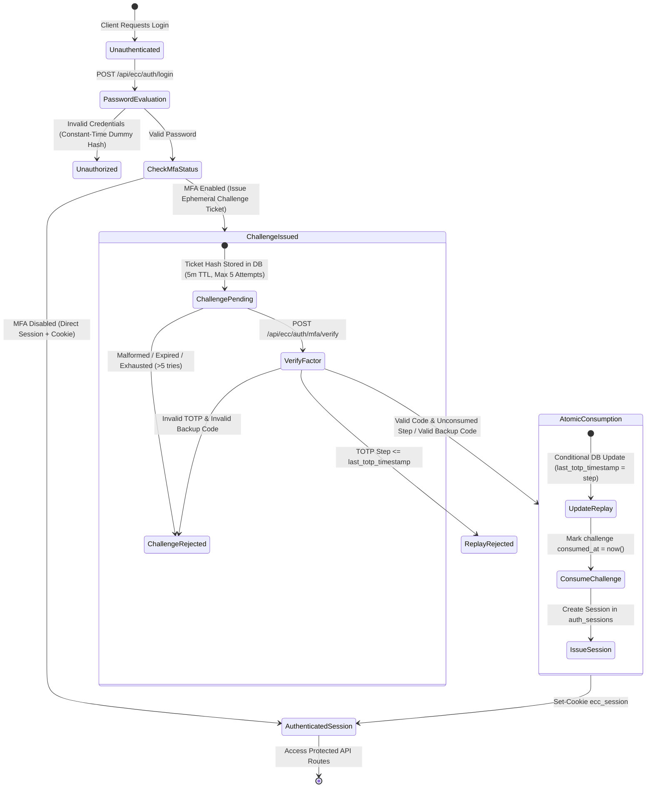
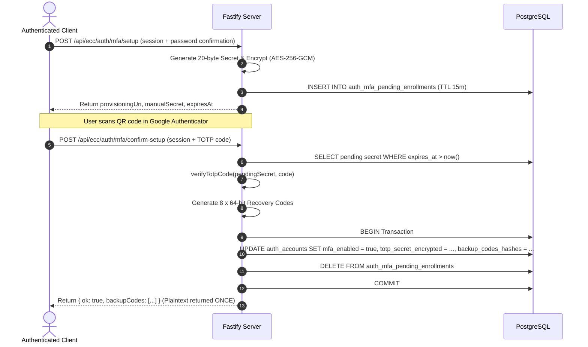

# Multi-Factor Authentication (MFA) — Phase 2: Authentication State Machine & Integration Theory

## 1. Executive Summary & Architecture Overview

Phase 2 transitions the Executive Cyber Risk Command Center (ECC) from standalone cryptographic primitives to a complete, database-backed authentication state machine. The primary security guarantee of Phase 2 is **strict state separation**: an account with MFA enabled **never** receives an authenticated session token, an `ecc_session` cookie, or access to protected endpoints merely by supplying a valid password.

Instead, password authentication terminates at an ephemeral, low-privilege **MFA Challenge Ticket**. A full session is issued only after an atomic, database-verified second factor proof (either an RFC 6238 TOTP time step or a cryptographically hashed single-use recovery code) is consumed.



---

## 2. Authentication State Machine: State Invariants

| State | Credential Proven | Authority Level | Can Access Protected Routes? | Token / Cookie Lifetime |
|---|---|---|---|---|
| **Unauthenticated** | None | Anonymous | No (Public routes only) | N/A |
| **MFA Challenge Issued** | Factor 1 (Password) | Ephemeral Verification Only | **No**. Rejected by all tenant & RBAC middleware | 5 minutes (or 5 failed attempts) |
| **Authenticated Session** | Factor 1 + Factor 2 (TOTP or Backup Code) | Full Role Principal (CISO, CXO, Auditor, etc.) | **Yes** (Subject to RBAC permissions) | 12 hours (`ecc_session` cookie) |

### Strict Defense-in-Depth Rules:
1. **No Intermediate Session Cookies:** When `mfa_enabled = true`, the response to `POST /api/ecc/auth/login` returns `{ mfaRequired: true, mfaTicket, expiresAt }` with HTTP status `200` but with **no** `Set-Cookie` header.
2. **Challenge Isolation:** The `mfaTicket` is a 32-byte base64url random ticket whose SHA-256 hash resides in `auth_mfa_challenges`. The ticket is **not** a JWT, contains no signed claims, and is rejected if passed to bearer authentication or session validation middleware.
3. **No Account Enumeration / Timing Disclosures:** If an invalid password is provided, password verification performs constant-time comparison against a dummy bcrypt hash, returning generic 401 `{ "error": { "code": "unauthorized", "message": "Invalid credentials." } }`. An attacker cannot deduce whether the account has MFA enabled before providing the correct password.

---

## 3. Ephemeral Challenge Security & Concurrency Defense

### 3.1 Challenge Life Cycle
1. **Creation:** 32 bytes of cryptographic randomness generated via `crypto.randomBytes(32).toString("base64url")`.
2. **Persistence:** Only the SHA-256 hash (`crypto.createHash("sha256").update(ticket).digest("hex")`) is saved to `auth_mfa_challenges`. Plaintext tickets are never stored in the database.
3. **Expiration:** Default `expires_at = now() + 5 minutes`. Expired tickets cannot be verified.
4. **Attempt Limit:** Strict threshold of 5 attempts. Each invalid code incrementation (`attempts = attempts + 1`) brings the challenge closer to terminal locking (`challenge_exhausted`).

### 3.2 Race Condition & Replay Prevention in Challenge Consumption
When multiple concurrent requests submit the same challenge ticket (e.g., automated brute force or network race conditions), the verification pipeline uses database-level atomic conditional updates:

```sql
UPDATE auth_mfa_challenges
SET consumed_at = now()
WHERE challenge_id = $1 AND consumed_at IS NULL;
```
If two requests execute concurrently, PostgreSQL's row-level locking ensures that only the first transaction gets `rowCount = 1`. The second receives `rowCount = 0` and is immediately terminated with `401 challenge_consumed`.

---

## 4. RFC 6238 TOTP Replay Prevention

### The Attack Vector:
A standard TOTP code is valid across a 30-second window (plus clock skew). If an eavesdropper intercepts a code or an employee logs in on an insecure terminal, an attacker who obtains the code could replay it within the remaining seconds of that 30-second window.

### The Defense: Monotonic Step Tracking
1. The database tracks `last_totp_timestamp` in `auth_accounts` as a `BIGINT` representing the exact RFC 6238 time step integer ($T = \lfloor \frac{\text{epoch ms}}{30000} \rfloor$).
2. During verification, `verifyTotpCode()` calculates the exact matched step.
3. Replay prevention is enforced at the database level using an atomic conditional update:
```sql
UPDATE auth_accounts
SET last_totp_timestamp = $2
WHERE account_id = $1
  AND (last_totp_timestamp IS NULL OR last_totp_timestamp < $2);
```
4. If a step $\le \text{last\_totp\_timestamp}$ is re-submitted, `rowCount` returns `0`, and the request is rejected with `401 code_replayed`.
5. When verification fails, `last_totp_timestamp` is **never** updated.

---

## 5. Enrollment Life Cycle & Pending State

To prevent incomplete or abandoned setups from locking users out of their accounts, enrollment employs a two-phase commit:



- Starting enrollment never sets `mfa_enabled = true`.
- Abandoned pending enrollments expire automatically after 15 minutes.
- Plaintext recovery codes are displayed exactly once upon successful confirmation; only SHA-256 hashes are persisted.

---

## 6. Recovery Codes & Single-Use Consumption

1. **Format:** 16 hexadecimal characters segmented into four blocks (`xxxx-xxxx-xxxx-xxxx`) delivering 64 bits of cryptographically secure random entropy.
2. **Storage:** Array of SHA-256 hashes in `auth_accounts.backup_codes_hashes`.
3. **Atomic Consumption:** When a recovery code is used during challenge verification, `verifyAndConsumeRecoveryCode()` removes the matched hash from the array and updates the account atomically.
4. **Immunity to Failed Attempts:** An invalid recovery code attempt never alters the stored hash array.

---

## 7. Account Management: Disable & Regeneration

### Disabling MFA:
- Requires an active authenticated session.
- Requires password reauthentication.
- Requires step verification: either the current TOTP code or an unused recovery code.
- Atomically clears `totp_secret_encrypted`, `totp_secret_iv`, `totp_secret_tag`, `mfa_enrolled_at`, `backup_codes_hashes`, and `last_totp_timestamp`.
- Invalidates any pending enrollments and marks unconsumed challenges as consumed.

### Regenerating Recovery Codes:
- Requires an active authenticated session, password reauthentication, and valid factor verification.
- Generates a new bundle of 8 codes, replaces the database array atomically, and returns the new plaintext codes once.
- Failures fail closed without destroying existing recovery codes.
